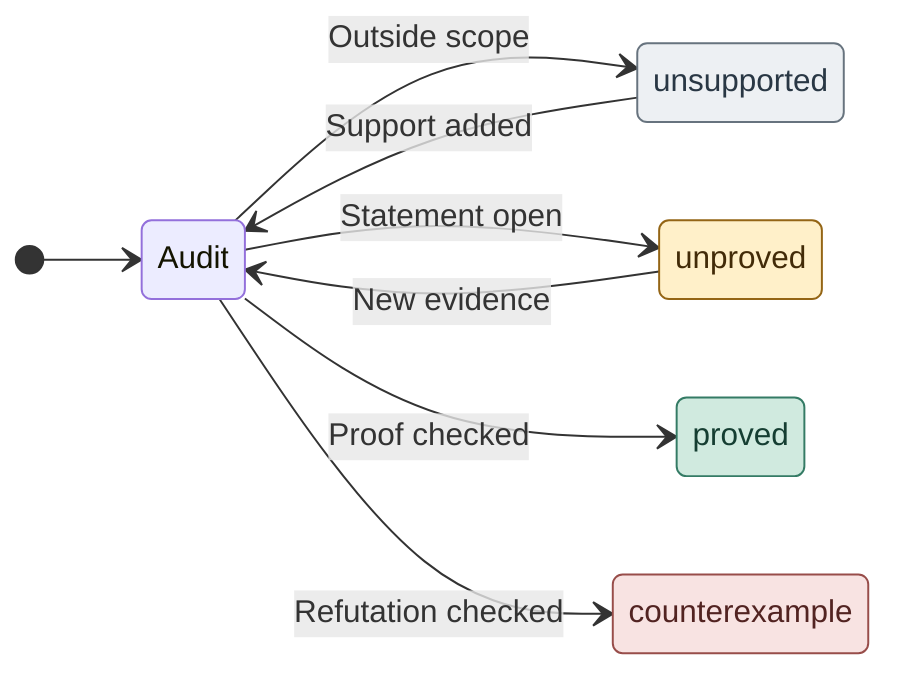

# Pipeline



1. **Conversion.** The Integration converter turns RUBI rules into the v0.1
   JSON format; the faithfulness check compares every v1 rule with its source
   rule.
2. **Statement and proof.** For each selected rule, Lean states a theorem with explicit
   hypotheses for a mathematical domain. The kernel checks completed proofs
   and counterexamples. Open cases keep their verification status.
3. **Export.** The exporter writes the v1 rule sets, the verification
   reports and the conformance cases; two exports must be byte-identical.
4. **Publication.** Each export becomes a Verification report named after the
   source digest of the Lean checkout, and `scripts/recheck.sh` reproduces it
   byte for byte. Currently: , with
    reports.
5. **Distribution.** The domain repositories, the Conformance suites
   ( cases, )
   and the client fixtures are copied from a published report and checked
   against it.

## Rule status

Read the diagram for **one rule, with its stated hypotheses, in one mathematical domain**. The exporter evaluates the available evidence for each report. A rule can enter the catalogue with a proof already checked, or acquire one in a later report.

**When is a proved rule certified?** The record also carries a `certified` flag. It is true exactly when the status is `proved` and every symbol has a `reviewed` or `formally_related` interpretation in that domain. The same rule can have different records over ℝ and ℂ. An invalid theorem declaration or a forbidden axiom stops the export. [Verification requirements V1-V-001–006](https://github.com/OpenSymbolicRules/Specification/blob/main/docs/osr-v1.md#6-verification-records-and-certification)

**How does this appear in the findings registry?** The domain columns display `counterexample` as **refuted**. A strengthened rule has its own ID and audit. Its proof applies to the added hypotheses, and the original retains its counterexample. **Not migrated** records a source rule considered before a v1 statement could be exported. [Power rule example](/findings/power-rule/) · [Findings registry](/findings/)
