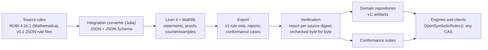

# Pipeline

1. **Conversion.** The Integration converter turns RUBI rules into the v0.1
   JSON format; the faithfulness check compares every v1 rule with its source
   rule.
2. **Statement and proof.** The Lean repository states each rule as a
   theorem per domain and proves it or proves a counterexample; the kernel
   replays every module.
3. **Export.** The exporter writes the v1 rule sets, the verification
   reports and the conformance cases; two exports must be byte-identical.
4. **Publication.** Each export becomes a Verification report named after the
   source digest of the Lean checkout, and `scripts/recheck.sh` reproduces it
   byte for byte. Currently: , with
    reports.
5. **Distribution.** The domain repositories, the Conformance suites
   ( cases, )
   and the client fixtures are copied from a published report and checked
   against it.
